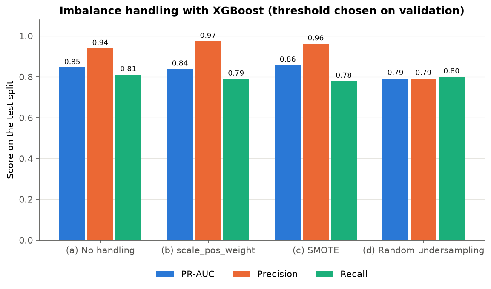

# Credit Card Fraud Detection

## Project

Detects fraudulent card transactions in a highly imbalanced dataset (about 0.17% fraud) and compares five frameworks on the same data split:

- XGBoost
- Keras
- PyTorch with fastai
- PyTorch with TabNet
- PyTorch with Lightning Flash (or plain Lightning if Flash does not install; see below)

Every model outputs a fraud probability. The main metrics are precision, recall, F1 and PR-AUC at a threshold chosen on the validation split. RMSE, MAE and R2 are also computed between the probability and the 0/1 label. The frameworks are scored on Simplicity, Transparency and Efficacy using rules written before any results existed (`docs/scoring_rules.md`).

Mini project for Machine Learning with Business Data.

## Team and roles

| Person | Name | Role |
|---|---|---|
| 1 | Vansh Sharma ([VanshSharmaPES](https://github.com/VanshSharmaPES)) | Data pipeline, EDA, XGBoost, imbalance experiment, README, decisions log |
| 2 | Vidhwath ([vidhwaths28](https://github.com/vidhwaths28)) | `src/evaluate.py`, Keras, Lightning / Flash, combined model, PPT |
| 3 | [yakshithn91-afk](https://github.com/yakshithn91-afk) | Scoring rules, `src/cost.py`, fastai, TabNet, money-based threshold, comparison |

## Dataset

- Credit card transactions by European cardholders over two days: 284,807 rows, 31 columns, 492 frauds.
- `V1`–`V28` are PCA components with no published meaning. Only `Time`, `Amount` and `Class` are original columns.
- Source: ULB Machine Learning Group, also on Kaggle as `mlg-ulb/creditcardfraud`. The course writeup links a copy at `media.geeksforgeeks.org`. `src/data.py` downloads the same file from the TensorFlow mirror (`storage.googleapis.com/download.tensorflow.org/data/creditcard.csv`) and checks the row, column and fraud counts before doing anything else.
- The raw file (about 144 MB) is never committed. `src/data.py` downloads it into `data/`, which is in `.gitignore`.

**Preparation (`src/data.py`)**

1. Drop 1,081 exact duplicate rows, leaving 283,726 rows and 473 frauds.
2. Add `Hour = (Time // 3600) % 24`, then drop `Time`.
3. Keep the raw amount as `Amount_raw` (used only for the money analysis), and use `log1p(Amount)` as the feature.
4. Do a stratified 60 / 20 / 20 split with seed 42.
5. Fit a `StandardScaler` on the 30 features of the train split only.

| Split | Rows | Frauds |
|---|---|---|
| Train | 170,235 | 284 |
| Validation | 56,745 | 94 |
| Test | 56,746 | 95 |

Class weight (train normal ÷ train fraud): 169,951 ÷ 284 = **598.4190**.

Every decision and the reason for it is logged in `docs/decisions.md`.

## How to run

### In Google Colab (optional reproduction)

1. Runtime → Change runtime type → **T4 GPU**.
2. Open a notebook from GitHub: File → Open notebook → GitHub tab → `VanshSharmaPES/credit-card-fraud-detection`.
3. Run the setup cell. It clones the repo into `/content/credit-card-fraud-detection` if needed, installs `requirements/base.txt` plus that framework's file, and runs `src/data.py`.
4. `01_eda` reads a GitHub token named `GH_TOKEN` from Colab Secrets (the key icon in the left sidebar). Add it there and allow notebook access. Never paste a token into a cell.

### On your own machine

```bash
git clone https://github.com/VanshSharmaPES/credit-card-fraud-detection.git
```

```bash
cd credit-card-fraud-detection
```

```bash
pip install -r requirements/base.txt -r requirements/xgboost.txt
```

```bash
python src/data.py
```

`python src/data.py` should print exactly the split table above. Then open a notebook from `notebooks/`. Install one framework's requirements file per environment, because the frameworks' packages can clash.

### Notebook order

| Notebook | What it does | Needs | Status |
|---|---|---|---|
| `00_checks` | Sanity checks for `src/evaluate.py` | base | On `main` |
| `01_eda` | Exploratory data analysis (train split only) | base | On `main` |
| `02_xgboost` | XGBoost, SHAP, permutation importance | `xgboost.txt` | On `main` |
| `03_keras` | Keras model | `keras.txt` | On `main` |
| `04_lightning` | Lightning (or Flash) model | `lightning.txt` | On `main` |
| `05_fastai` | fastai model | `fastai.txt` | Pending |
| `06_tabnet` | TabNet model and feature masks | `tabnet.txt` | Pending |
| `07_imbalance` | Class weight vs SMOTE vs undersampling (XGBoost) | `xgboost.txt` | On `main` |
| `08_ensemble` | Average of the best models (runs `src/ensemble.py`) | base | On `main` |
| `09_money` | Money-based threshold | base | Pending |
| `10_comparison` | Final tables and charts (reads `results/` and `preds/` only) | base | Pending |

Notebooks `02`–`07` write `results/NAME.json`, `preds/NAME_val.csv`, `preds/NAME_test.csv` and a model in `models/`. `08`–`10` only read those files.

## Results

All numbers are on the test split, at the threshold chosen on validation, copied from `results/*.json`. Every run is on CPU (XGBoost: AMD Ryzen 5 5600H; Keras, Lightning: Apple Silicon ARM64). No GPU run was done. Each JSON file also has the threshold, confusion counts, hardware and notes.

| Framework | Precision | Recall | F1 | PR-AUC | ROC-AUC | RMSE | MAE | R2 | Train (s) |
|---|---|---|---|---|---|---|---|---|---|
| XGBoost | 0.9740 | 0.7895 | 0.8721 | 0.8382 | 0.9719 | 0.0203 | 0.0007 | 0.7529 | 5.538 |
| Keras | 0.7957 | 0.7789 | 0.7872 | 0.7103 | 0.9628 | 0.1708 | 0.1186 | -16.4565 | 1.207 |
| fastai | — | — | — | — | — | — | — | — | — |
| TabNet | — | — | — | — | — | — | — | — | — |
| Lightning | 0.8824 | 0.7895 | 0.8333 | 0.7576 | 0.9629 | 0.1072 | 0.0266 | -5.8776 | 9.991 |
| Combined | 0.9615 | 0.7895 | 0.8671 | 0.8501 | 0.9685 | 0.0846 | 0.0487 | -3.2800 | — |

The XGBoost row is from `notebooks/02_xgboost.ipynb`. The Combined row was built from an earlier XGBoost run and will be updated when `08_ensemble` is re-run.

### Imbalance experiment (XGBoost, `07_imbalance`)

| Version | Train rows | `scale_pos_weight` | Precision | Recall | F1 | PR-AUC |
|---|---|---|---|---|---|---|
| (a) No handling | 170,235 | 1 | 0.9390 | 0.8105 | 0.8701 | 0.8451 |
| (b) Class weight | 170,235 | 598.4190 | 0.9740 | 0.7895 | 0.8721 | 0.8382 |
| (c) SMOTE (train only) | 339,902 | 1 | 0.9610 | 0.7789 | 0.8605 | 0.8572 |
| (d) Random undersampling (train only) | 568 | 1 | 0.7917 | 0.8000 | 0.7958 | 0.7922 |

Validation and test are never resampled. Files: `results/imbalance/`, `preds/imbalance/`.

### Key figures

| Figure | File |
|---|---|
| Class balance | [`figures/eda_class_balance.png`](figures/eda_class_balance.png) |
| Amount by class | [`figures/eda_amount_by_class.png`](figures/eda_amount_by_class.png) |
| Fraud rate by hour | [`figures/eda_hour_pattern.png`](figures/eda_hour_pattern.png) |
| Correlation with `Class` | [`figures/eda_corr_with_class.png`](figures/eda_corr_with_class.png) |
| Top fraud-linked features | [`figures/eda_top_features.png`](figures/eda_top_features.png) |
| Feature correlation heatmap | [`figures/eda_heatmap.png`](figures/eda_heatmap.png) |
| XGBoost gain importance | [`figures/xgb_feature_importance.png`](figures/xgb_feature_importance.png) |
| XGBoost SHAP summary | [`figures/xgb_shap_summary.png`](figures/xgb_shap_summary.png) |
| XGBoost SHAP, one caught fraud | [`figures/xgb_shap_case.png`](figures/xgb_shap_case.png) |
| Imbalance comparison | [`figures/imbalance_comparison.png`](figures/imbalance_comparison.png) |



Simplicity / Transparency / Efficacy scores: _pending (`notebooks/10_comparison.ipynb`)._

**Lightning Flash:** The local Flash install attempt failed (`Cannot import setuptools.build_meta`); plain PyTorch Lightning was used. Flash and Colab/GPU runs have not been verified.

Person 2 results and caveats: [`docs/person2_results.md`](docs/person2_results.md). Presentation: [`output/Person2_Results_Presentation.pptx`](output/Person2_Results_Presentation.pptx). fastai and TabNet results are pending their assigned work.

## Repo structure

```
credit-card-fraud-detection/
├── src/
│   ├── data.py          # download, clean, split, scale; load_splits()
│   ├── evaluate.py      # threshold, metrics, results/preds files, permutation importance
│   ├── model_keras.py   # Keras model definition
│   ├── model_lightning.py  # Lightning model definition
│   ├── ensemble.py      # combined model: averages the top models by validation PR-AUC
│   └── cost.py          # money-based cost functions (pending)
├── notebooks/           # one notebook per task (see the table above)
├── results/             # one metrics JSON per model; imbalance/ for the experiment; perm_*.csv
├── preds/               # validation and test probabilities per model (row_id, y_true, y_prob)
├── models/              # saved trained models
├── figures/             # every chart used in the report and PPT
├── docs/                # decisions log, simplicity notes, Person 2 results (scoring rules, EDA findings, viva questions to come)
├── output/              # presentation files
├── requirements/        # base.txt plus one file per framework
└── data/                # created by src/data.py, never committed
```
