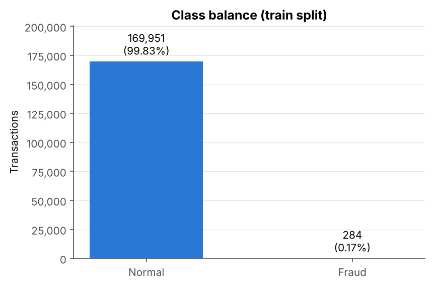
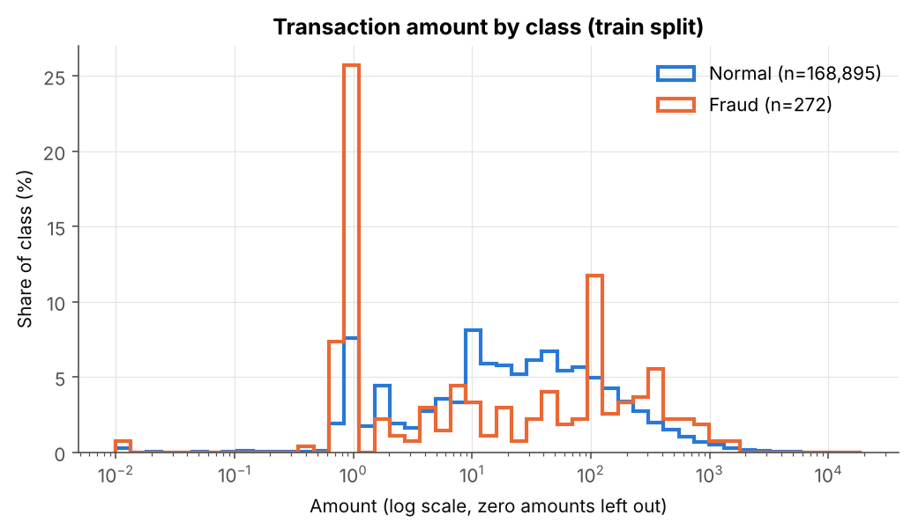
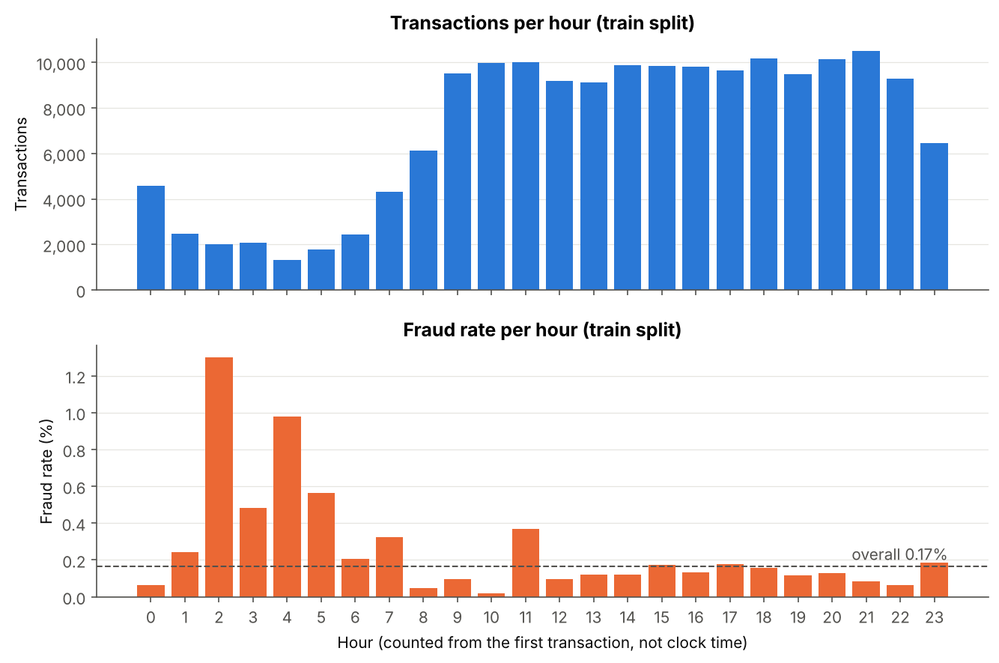
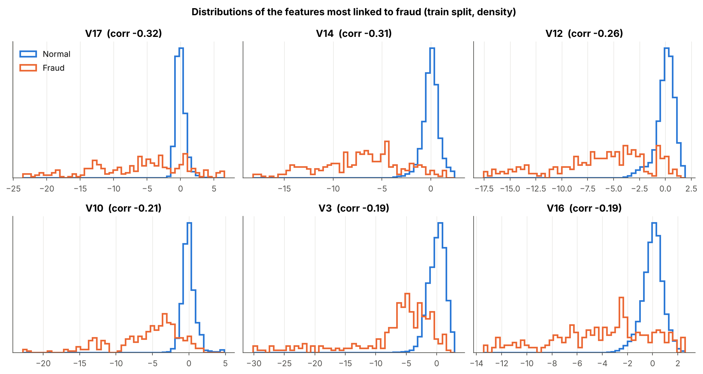
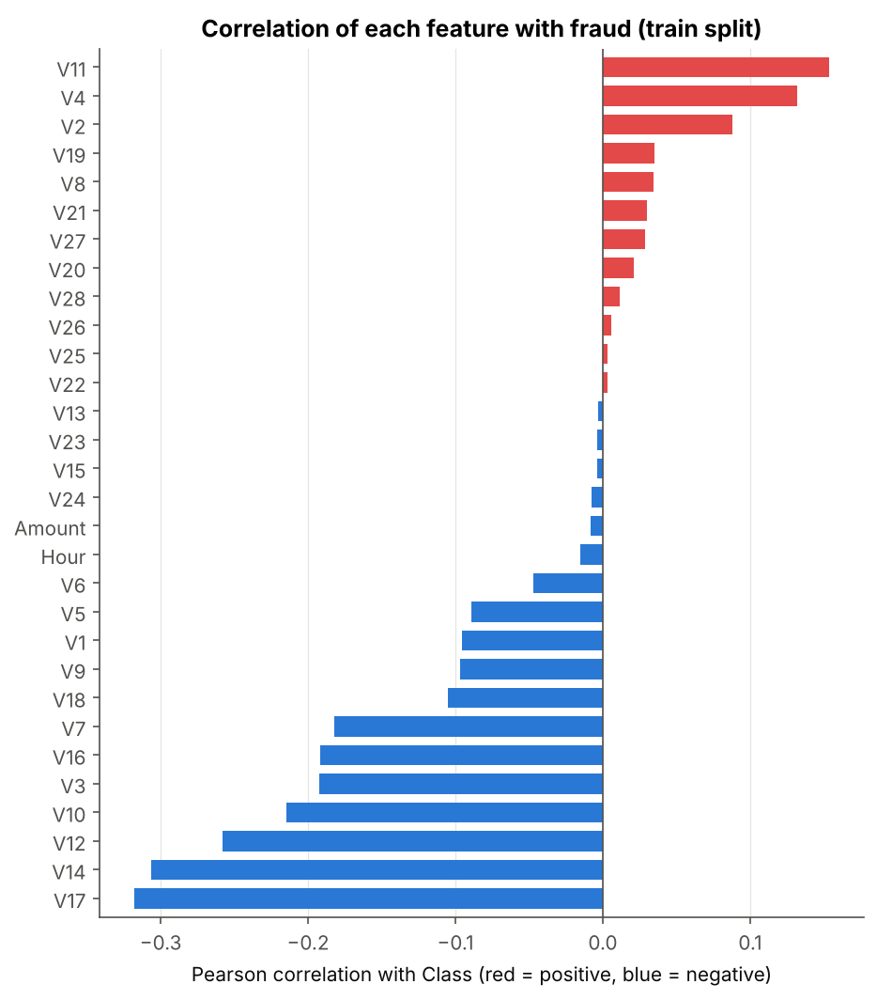
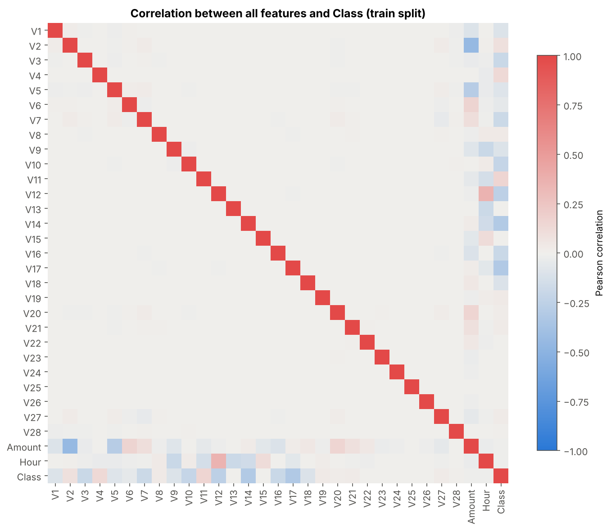
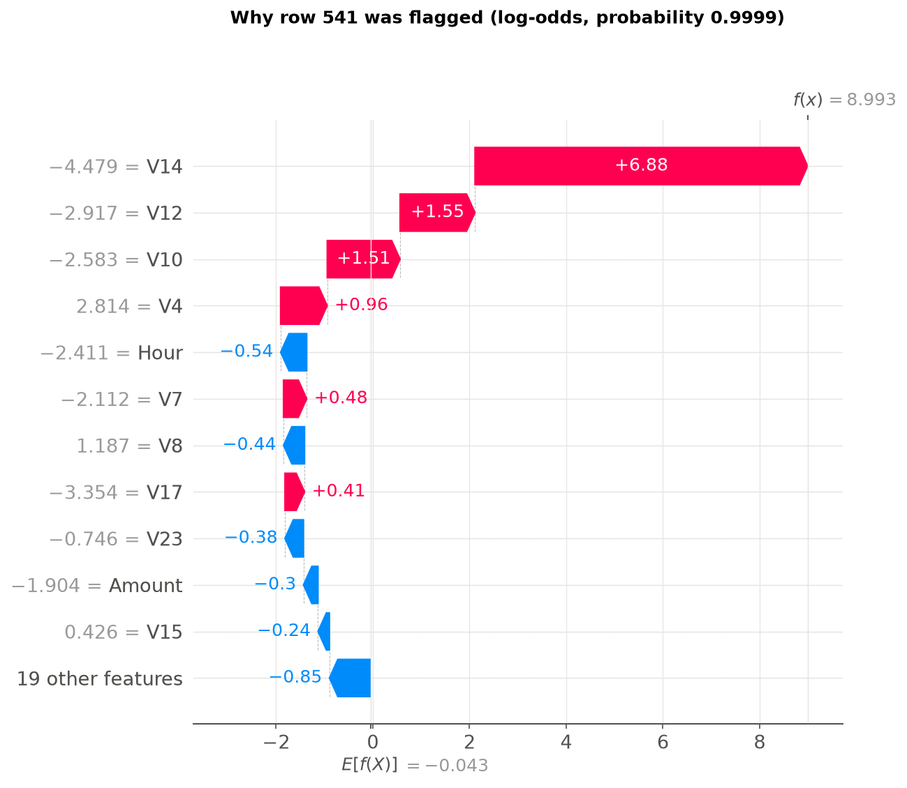

# Credit Card Fraud Detection

Framework comparison and transaction analysis

Machine Learning with Business Data

Vansh Sharma · Vidhwath S · Yakshith Naidu

Project repository

https://github.com/VanshSharmaPES/credit-card-fraud-detection

## Introduction

Credit card fraud detection asks whether a transaction should be flagged for investigation. Missing fraud leaves fraudulent activity undetected, while incorrectly flagging normal transactions creates unnecessary review work. A useful comparison therefore needs to consider both the frauds caught and the false alerts produced.

The dataset contains very few frauds relative to normal transactions. A model can achieve high accuracy by predicting almost every transaction as normal, so accuracy alone is inadequate. Precision measures the fraction of alerts that are fraud; recall measures the fraction of frauds detected. F1 combines these measures at a selected threshold, while PR-AUC summarizes ranking performance across thresholds.

The project compares XGBoost, Keras, fastai, TabNet and PyTorch Lightning using the same data preparation and held-out splits. It also examines imbalance handling, explains XGBoost predictions with SHAP and evaluates a combined model. The following sections describe the methodology, exploratory analysis, results and limitations. Framework documentation is listed in the references.

## Methodology

The raw ULB dataset has 284,807 transactions, 31 columns and 492 frauds, collected from European cardholders over two days. V1–V28 are anonymized PCA components. The pipeline downloads a copy from the TensorFlow mirror and checks the raw dimensions and fraud count. It removes 1,081 exact duplicate rows, including 19 frauds, leaving 283,726 rows and 473 frauds [1, 2].

The 30 model inputs are V1–V28, log1p(Amount) and Hour. Hour is (Time // 3600) % 24, measured from the first transaction rather than known clock time. Amount_raw is retained for cost analysis and excluded from the predictors. A stratified 60/20/20 split uses seed 42. StandardScaler is fitted only on the training rows.

| Split | Rows | Frauds |
| --- | --- | --- |
| Train | 170,235 | 284 |
| Validation | 56,745 | 94 |
| Test | 56,746 | 95 |

Table 1. Shared data splits from src/data.py.

Each model outputs a fraud probability. Operating thresholds are chosen on validation data before evaluating test predictions. PR-AUC in the evaluation code is average precision. RMSE, MAE and R² compare probabilities with the binary label and are secondary measures. The ensemble averages XGBoost, Lightning and fastai, selected using validation PR-AUC. Plain Lightning is used because the recorded Flash installation failed [2–7].

## EDA

Figures 1–6 describe the training split. Raw amount summaries use the original amounts; model-feature correlations use log1p(Amount). The analysis does not use validation or test rows to choose these findings.

Figure 1. Class balance in the training split.

The training split contains 169,951 normal transactions and 284 frauds, so fraud accounts for only about 0.17% of its 170,235 rows. Predicting every transaction as normal would give about 99.83% accuracy while detecting no fraud. This makes accuracy alone misleading; the evaluation also needs precision, recall, F1 and PR-AUC.

Figure 2. Amount distributions by class on a logarithmic axis.

The median amount is lower for fraud than for normal transactions: 9.17 compared with 22.00. However, the mean is higher for fraud: 111.42 compared with 88.27. This difference between the medians and means shows why a typical transaction cannot be described by the mean alone. Large amounts also occur among normal transactions: the maximum is 18,910.00 for normal transactions and 1,504.93 for fraud. The chart uses a logarithmic amount axis and excludes the 12 fraud and 1,056 normal transactions with zero amount; the summary statistics include them.

### Transaction timing and feature distributions

Figure 3. Transaction counts and fraud rates by elapsed-hour bin.

The largest observed fraud rates occur in hour bin 2, with 26 frauds out of 2,002 transactions (1.30%), and bin 4, with 13 out of 1,329 (0.98%). These rates are based on small fraud counts, so they should be treated cautiously. Bin 11 contains the most frauds, 37, but its rate is lower at 0.37% because it contains 10,029 transactions. Here, Hour = (Time // 3600) % 24 measures hours from the first transaction and wraps every 24 hours. These bins are not known clock times.

Figure 4. Distributions of the six features most correlated with fraud.

Fraud transactions tend to have lower values than normal transactions for the six features shown: V17, V14, V12, V10, V3 and V16. For example, the median V14 value is -6.79 for fraud and 0.05 for normal transactions; for V17, the medians are -5.46 and -0.06. The distribution plots reveal class separation that the correlation coefficients alone do not fully describe, although the distributions still overlap. Since V1–V28 are anonymized PCA components, these patterns cannot be assigned specific transaction meanings.

### Correlation with fraud

Figure 5. Pearson correlation between each model feature and Class.

V17 and V14 have the strongest absolute Pearson correlations with Class, at approximately -0.3178 and -0.3066, followed by V12 at -0.2577. The strongest positive correlations are V11 at about +0.1535 and V4 at +0.1321. By comparison, the correlations for log1p(Amount) and Hour are close to zero, at -0.0083 and -0.0152. These values measure linear association only; a small correlation does not establish that a feature is useless to a model that can learn nonlinear patterns or interactions.

### Correlation between features

Figure 6. Correlation heatmap for the model features and Class.

The V features have small pairwise linear correlations in the training split: the largest absolute correlation is about 0.047 and the median is about 0.002. Larger associations appear when the other model features are included, especially V2 with log1p(Amount) at -0.448 and V12 with Hour at +0.352. The low correlations among V features do not prove that they are independent, because Pearson correlation does not capture every kind of relationship.

The heatmap and feature distributions provide complementary views: the heatmap summarizes linear relationships, while the class-specific distributions show differences in location, spread and overlap. Neither identifies a causal reason for fraud.

## Results

| Model | Precision | Recall | F1 | PR-AUC |
| --- | --- | --- | --- | --- |
| XGBoost | 0.9740 | 0.7895 | 0.8721 | 0.8382 |
| Keras | 0.7957 | 0.7789 | 0.7872 | 0.7103 |
| fastai | 0.8837 | 0.8000 | 0.8398 | 0.7377 |
| TabNet | 0.7976 | 0.7053 | 0.7486 | 0.6833 |
| Lightning | 0.8824 | 0.7895 | 0.8333 | 0.7576 |
| Combined | 0.9494 | 0.7895 | 0.8621 | 0.8488 |

Table 2. Test metrics at thresholds selected on validation. Source: results/*.json.

XGBoost catches 75 of 95 test frauds with two false alerts, giving precision 0.9740 and F1 0.8721. Among the individual models, fastai catches the most frauds, 76, with ten false alerts. The combined model has PR-AUC 0.8488 and F1 0.8621. Its PR-AUC exceeds those of the five individual framework models, but its F1 is lower than XGBoost’s. These comparisons describe this saved split and do not establish a statistically significant ranking.

### Imbalance handling

| Method | Precision | Recall | F1 | PR-AUC |
| --- | --- | --- | --- | --- |
| No handling | 0.9390 | 0.8105 | 0.8701 | 0.8451 |
| Class weight | 0.9740 | 0.7895 | 0.8721 | 0.8382 |
| SMOTE | 0.9610 | 0.7789 | 0.8605 | 0.8572 |
| Undersampling | 0.7917 | 0.8000 | 0.7958 | 0.7922 |

Table 3. XGBoost imbalance experiment. Source: results/imbalance/*.json.

Class weighting has the highest F1, 0.8721, while SMOTE has the highest PR-AUC, 0.8572, among these four runs. No handling has the highest recall, 0.8105. Undersampling reduces training to 568 rows and gives F1 0.7958. SMOTE expands training to 339,902 rows. Resampling is applied only to training; validation and test retain their natural class distribution. The small F1 difference between weighting and no handling should not be presented as a universal advantage.

The published model results are CPU runs on different hardware, so recorded times do not support a controlled speed ranking. Later verification on a local GPU reproduced the displayed XGBoost and imbalance metrics to four decimal places; it did not replace the saved CPU results.

### Explaining XGBoost predictions

SHAP attributes a model output to feature contributions relative to a baseline [8]. In this project, the contributions sum to log-odds, not directly to probability. A positive contribution increases the model’s fraud score and a negative contribution decreases it. These explanations describe model behavior rather than causation.

Figure 7. SHAP explanation of validation transaction row 541.

Figure 7 explains the caught validation fraud with the lowest row_id, 541, whose predicted probability is 0.9999 at threshold 0.9394. The global SHAP summary uses 2,000 validation rows, including only three frauds. V14 has the largest mean absolute SHAP contribution in that sample. The summary therefore describes that sampled population and should not be described as a comprehensive survey of fraud cases.

### Framework scores and cost analysis

The draft XGBoost scores are Simplicity 4, Transparency 4 and Efficacy 5. Its training and prediction cells contain 13 nonblank, noncomment lines. Its test PR-AUC is 0.0106 below the best framework comparison result, within the rubric’s 0.02 band for Efficacy 5. The rubric was written after some results were available; subjective scores still require team agreement.

At the assumed review fee of 10 amount units, XGBoost’s validation-selected F1 threshold saves 9,287.36 amount units on test, compared with 5,793.01 for its validation-cost threshold. Both thresholds were selected using validation data. The difference illustrates that optimizing validation cost does not guarantee lower cost on test; test outcomes must not be used to retune the threshold.

### Additional evaluation results

Table 4 reports the probability regression metrics for all six compared models. These metrics supplement the classification results in Table 2.

| Model | RMSE | MAE | R2 |
| --- | --- | --- | --- |
| XGBoost | 0.0203 | 0.0007 | 0.7529 |
| Keras | 0.1708 | 0.1186 | -16.4565 |
| fastai | 0.0869 | 0.0269 | -3.5168 |
| TabNet | 0.1769 | 0.0899 | -17.7280 |
| Lightning | 0.1072 | 0.0266 | -5.8776 |
| Combined | 0.0631 | 0.0181 | -1.3815 |

Table 4. Test probability regression metrics from results/*.json.

Negative R2 means the probability predictions have greater squared error than a constant prediction equal to the test-label mean. XGBoost has the lowest RMSE and MAE and the highest R2 in this comparison.

### Framework score evidence

Table 5 records the draft Simplicity (S), Transparency (T) and Efficacy (E) scores alongside precision and recall from Table 2. Scores remain subject to team agreement because the rubric was written after some results were available.

| Model | S | T | E | Precision | Recall |
| --- | --- | --- | --- | --- | --- |
| XGBoost | 4 | 4 | 5 | 0.9740 | 0.7895 |
| Keras | 3 | 2 | 2 | 0.7957 | 0.7789 |
| fastai | 3 | 2 | 2 | 0.8837 | 0.8000 |
| TabNet | 3 | 5 | 2 | 0.7976 | 0.7053 |
| Lightning | 2 | 2 | 3 | 0.8824 | 0.7895 |

Table 5. Draft framework scores from results/model_scores_draft.csv.

Simplicity evidence records 13 training/prediction lines for XGBoost, 40 for Keras, 37 for fastai, 40 for TabNet and 65 for Lightning. XGBoost uses six non-default settings. Its gain importance and SHAP case support Transparency 4; the PR-AUC gap of 0.0106 supports Efficacy 5. TabNet supplies global importance and per-row masks. Keras, fastai and Lightning use aggregate permutation importance. Lightning also records the Flash installation failure. Timings come from different CPU environments and are not a controlled speed comparison.

### Money-based threshold comparison

Table 6 compares savings on test at the validation-selected F1 and cost thresholds, using the same assumed review fee of 10 amount units. Savings equal the loss from missing every fraud minus the review fees and missed-fraud amounts under the model.

| Model | F1 savings | Cost savings |
| --- | --- | --- |
| Combined | 9,267.36 | 7,196.48 |
| fastai | 9,626.34 | 9,626.34 |
| Keras | 6,082.16 | 6,082.16 |
| Lightning | 9,624.95 | 9,624.95 |
| TabNet | 8,313.51 | 8,313.51 |
| XGBoost | 9,287.36 | 5,793.01 |

Table 6. Test savings from results/money_f1_vs_cost.csv at review fee 10.

The two threshold rules give the same test savings for four models. The F1 rule gives higher test savings for XGBoost and the combined model. These are held-out comparisons, not a reason to tune thresholds on test.

## Conclusion

XGBoost provides the strongest individual F1 and precision in these experiments. The combined model improves PR-AUC over the five individual framework runs, while fastai catches one more test fraud than XGBoost at their selected thresholds. These results support comparing false-alert workload, missed fraud and ranking performance together rather than choosing a model from accuracy alone.

The imbalance experiment shows that the preferred treatment depends on the metric: class weighting gives the best F1, SMOTE gives the best PR-AUC and the untreated baseline gives the highest recall. SHAP makes individual XGBoost outputs easier to inspect, but it does not reveal the original meanings of the anonymized components or establish causal explanations.

The dataset covers only two days and a specific cardholder population. The random split measures performance within that dataset rather than future performance under changing fraud patterns. A follow-up should use a later time-based holdout, broader operational data and review costs measured for the intended setting. The present results do not establish production readiness.

### References

[1] ULB dataset on Kaggle. https://www.kaggle.com/datasets/mlg-ulb/creditcardfraud

[2] Project source and saved artifacts. https://github.com/VanshSharmaPES/credit-card-fraud-detection

[3] XGBoost documentation. https://xgboost.readthedocs.io/en/stable/

[4] Keras documentation. https://keras.io/

[5] fastai documentation. https://docs.fast.ai/

[6] PyTorch Lightning documentation. https://lightning.ai/docs/pytorch/stable/

[7] PyTorch TabNet implementation. https://github.com/dreamquark-ai/tabnet

[8] SHAP documentation. https://shap.readthedocs.io/en/latest/

Dataset mirror used by src/data.py: https://storage.googleapis.com/download.tensorflow.org/data/creditcard.csv
